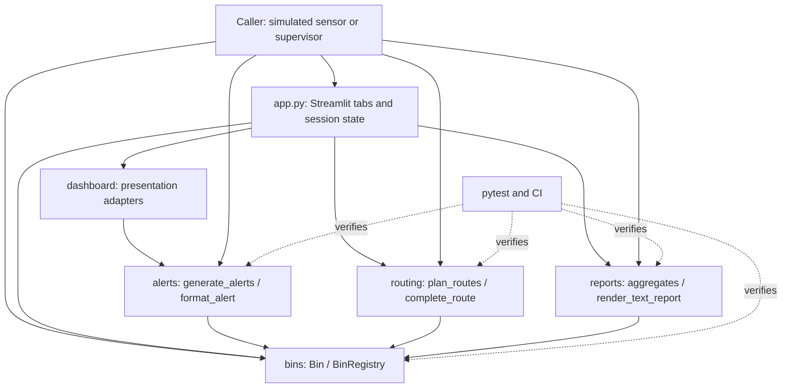
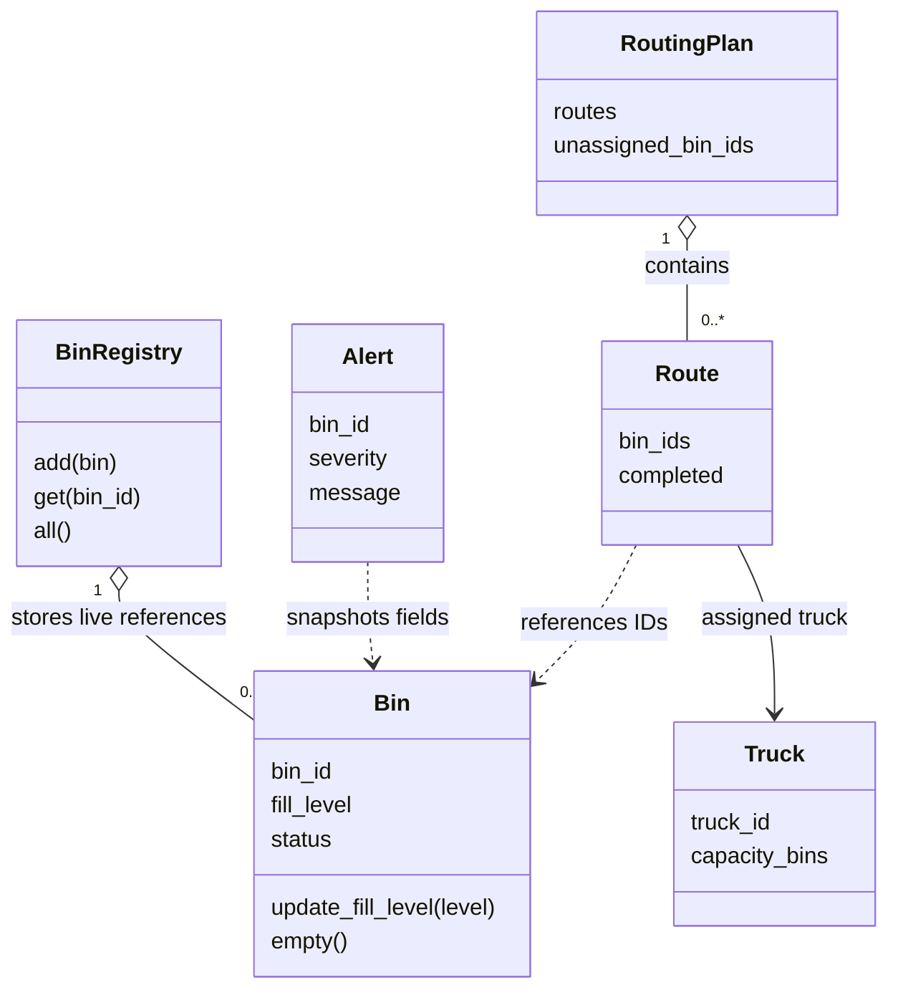

# Software Architecture and Design Specification

**Project:** Smart City Waste Management System
**Document:** SAD-SCWM-1.6
**Author:** Shreya Yashodhara Singh (`yasho-26singh`)
**Date:** 10 November 2026
**Status:** Maintained architecture/evidence record; repository approvals are recorded below; no institutional acceptance claimed
**Integrated source/requirements baseline:** main `d9719bf5c1048cc9c25cfa3b385b930915eaa1aa`

Dashboard session guidance (#28) and routing validation (#29) are merged.
SAD v1.5 (#30) and SRS v2.2 (#31) are also merged. Subsequent editorial revisions
follow the same independent-review process; preparation alone implies no approval.

## Revision History

| Version | Date | Author | Change Summary |
|---|---|---|---|
| 1.0 | 8 November 2026 | Shreya | Initial SAD, merged in PR #6; editorial cleanup in #7 |
| 1.1 | 9 November 2026 | Shreya | Align with integrated reports/STP; follow supplied SAD template; add risks, stakeholder concerns, security assessment and provisional SRS v2 crosswalk |
| 1.2 | 9 November 2026 | Shreya | Add proposed UI sequence; reconcile accepted SRS v2 and merged recording evidence |
| 1.3 | 9 November 2026 | Shreya | Reflect approved UI/SAD merges and distinguish domain dependencies from the browser presentation layer |
| 1.4 | 10 November 2026 | Shreya | Reconcile merged demo/filter/edge-test status; document proposed backlog notices and empty-state guidance |
| 1.5 | 10 November 2026 | Shreya | Reconcile merged #28/#29, manual-route and fleet error contracts, and domain-only compatibility evidence |
| 1.6 | 10 November 2026 | Shreya | Record actual #30/#31 integration and separate completed documentation from pending final report/course acceptance work |

## Approvals

| Role | Name | Signature/Date |
|---|---|---|
| Author | Shreya Yashodhara Singh | Prepared 10 November 2026 |
| SAD v1.5 independent reviewer | Sasyak Subudhi | [Approved #30 head 43af049 on 10 November 2026](https://github.com/SasyakSubudhi/Smart-City-Waste-Management-System/pull/30#pullrequestreview-5839776371) |
| SAD v1.5 independent reviewer | Shriya Vasundhara Singh | [Approved the same #30 head on 10 November 2026](https://github.com/SasyakSubudhi/Smart-City-Waste-Management-System/pull/30#pullrequestreview-5840200521) |
| SAD v1.5 repository integration | PR #30 | Normal merge 93c82bf19862088730f7d7ae05d4b2f9cdf2184c, 10 November 2026 |
| Subsequent editorial revisions | Independent teammate review required | Refer to the relevant live PR; the v1.5 approvals do not approve later edits |
| Course evaluator | Not recorded | No approval inferred |

## 1. Introduction

### 1.1 Purpose
Specify the actual architecture and design of the integrated Python package for
bin monitoring, alerts, priority collection and city reporting. This is an
IEEE-style description, not a claim of formal standards certification.

### 1.2 Scope
The baseline contains all four domain modules, unit/system tests, STP, test
document/report generators and published testing reports. Reports are implemented
and STP is merged. This document preserves historical test results and distinguishes
integrated behavior from pending document approval and course acceptance.

PR #16 has now merged the Streamlit UI after independent approval and passing
checks; PR #17 has merged the architecture update. PR #14 has merged the
command-line demo, PR #19 the alert edge tests and PR #22 the severity filter.
PR #28 supplies session/backlog guidance and PR #29 strengthens routing input
validation without changing planner-created route shapes or the UI APIs.
UI integration is complete, while final team/course
acceptance and accessibility acceptance remain separate and are not inferred.

### 1.3 Audience
Administrators/supervisors, developers, testers, maintainers and course evaluators.

### 1.4 Definitions
Bin fill is an integer percentage. Capacity for routing counts bins, not litres.
Backlog means due bins not assigned to the fleet. See glossary in section 5.1.

## 2. Document Overview

### 2.1 How to use this document
Section 3 describes architecture, boundaries, risks and requirement allocation.
Section 4 gives runtime sequences, APIs and operational limitations. Section 5
maps this document to the supplied SAD template and links the evidence. Preserve
the distinction between merged behavior, historical measurements and pending PRs.

### 2.2 Related Documents
[SRS](SRS.md), [STP](STP.md), [routing contract](ROUTING.md),
[Test Case Document](Test_Case_Document.md), [Day 3 validation](DAY3_VALIDATION.md),
[Unit Test Report](Unit_Test_Report.md), [System Validation Report](System_Validation_Report.md),
[Code Coverage Report](Code_Coverage_Report.md), [Branch Coverage Report](Branch_Coverage_Report.md).
SRS v2 PR #13 is now merged in the stated baseline. Section 3.8 allocates its
FR-1..16, NFR-1..6 and SR-1..5. The review/merge does not by itself prove every
quality requirement; partial portability, ordering and process evidence stay qualified.

## 3. Architecture

### 3.1 Goals & Constraints
Keep status policy in one domain model; expose deterministic alert and collection
behavior; prevent validated operations from silently corrupting existing readings;
support isolated tests and independent feature review. The package targets Python
3.10+ with standard-library runtime dependencies. Full-suite CI uses Windows/Python
3.12; local checks use Python 3.13.7. Domain-only Windows CI also verifies Python
3.10.11 and 3.11.9; those jobs exclude Streamlit/AppTest and the dashboard adapter.
That is not a test of every supported version or operating system.
No hardware, road network, database, persistence or multi-user dispatch is present.
The four domain modules use only the standard library. The merged Streamlit
presentation layer requires Streamlit and its transitive dependencies from
requirements.txt and introduces a local browser/server boundary. Merged SRS v2.2
(#31), following v2.1, distinguishes these dependencies and records the verified
domain versions without inferring UI compatibility on 3.10/3.11.

### 3.2 Stakeholders & Concerns
| Stakeholder | Concern | Design response / limit |
|---|---|---|
| Administrator | Reliable inventory and summaries | Unique registry IDs; report functions read current bins; process exit loses data |
| Supervisor/crew | Overflow priority and safe completion | Critical-first alerts, fullest-first routes, capacity/backlog and guarded completion; caller confirms actual trip |
| Sensor simulator | Reject malformed readings | Bin.update_fill_level validates before assignment |
| Teammates/maintainers | Stable interfaces and attribution | Separate modules, explicit contracts, feature PRs and independent review |
| Testers/evaluators | Reproducible evidence and traceability | Test IDs, source baseline, coverage and explicit pending status; no fabricated approvals |

### 3.3 Component (UML) Diagram
The dependency view below shows components and their provided contracts; arrows
mean uses/reads, not network messages or deployment processes.



### 3.4 Component Descriptions
This UML class view complements the component dependency diagram with the main
registry/plan/route relationships.



| Component | Responsibility | Owner / state |
|---|---|---|
| bins | Bin data, validation, status, registry and emptying | Sasyak; merged |
| alerts | Frozen alert snapshots, severity priority and plain-text format | Shreya; merged |
| routing | Validate fleet/threshold, allocate due bins, expose backlog, confirm completion | Shriya; merged |
| reports | Mean fill, status counts, means by waste type, total in text report | Shruti; merged |
| app.py / dashboard | Four tabs, session state, clean domain errors, table adapters, severity filter, plan invalidation and backlog-aware confirmation | Shreya; merged through #16, #22 and #28 |
| tests / report generators | Unit/system/UI validation and recorded evidence | Integrated team work; historical reports remain tied to their recorded commits |

Data flow: caller updates a registry Bin, then passes registry.all() to alerts
and reports. Planning receives the registry itself and creates a RoutingPlan.
After operator confirmation, complete_route empties selected bins. Callers must
regenerate alerts and reports; previously returned values are snapshots.

### 3.5 Chosen Architecture Pattern and Rationale
Use a modular, domain-centred design with a caller/presentation boundary over the
domain model and read-only feature services. Bin owns status boundaries, so alerts
and reports do not duplicate policy. Passed registries avoid hidden global state.
Ordinary functions make tests inexpensive and deterministic. Separate services,
databases and geographic optimization would add unsupported complexity. This is
not a microservice deployment or a database-backed layered application.

### 3.6 Technology Stack & Data Stores
Python dataclasses, lists, tuples and dictionaries; pytest/pytest-cov and
coverage.py for tests; GitHub Actions for CI; Mermaid for diagrams. No persistent
data store is implemented. BinRegistry holds a dictionary of mutable Bin objects;
all() returns a new list containing the same objects. Bin.status derives from
fill_level: below 70 OK; 70..89 NEARLY_FULL; 90..100 FULL.

Alert is frozen with bin_id/severity/message. Old alerts never update themselves.
Truck is frozen with truck_id/capacity_bins. Route has truck, tuple bin_ids and
mutable completed flag. RoutingPlan is frozen but contains mutable Routes: it is
not deeply immutable. Report functions return numeric/dictionary/string snapshots;
the text report sorts waste-type lines. Empty input yields mean 0.0, zero status
counts, empty waste-type means and `No bins registered.`.

### 3.7 Risks & Mitigations
| Risk | Existing mitigation | Residual risk / next owner action |
|---|---|---|
| Malformed reading | Type/range checks before assignment | Public attributes can bypass setters; trusted callers use supported methods |
| Stale/missing route bins | Resolve every ID before emptying; reject repeat completion | No reservations or versioning; caller manages one active nonoverlapping plan |
| Data loss | No hidden disk writes | Process memory is volatile; persistence is a future requirement |
| Outdated alerts/reports | Read-only regeneration from current registry | Caller must refresh snapshots after changes |
| Large fleet/data | Simple priority sort and bounded assignment | No real-city load benchmark; unbounded inputs may exhaust resources |
| Documentation drift | Explicit source baseline and requirement crosswalk | Reconcile accepted #28/#29 here; SRS and final report updates stay with their owners |
| Misstated evidence | Keep historical snapshots and exact run counts separate | Recording artifacts are merged; course acceptance, board fields and full version range remain unverified |

### 3.8 Traceability to Requirements
The first table covers the original FR-1..8/NFR-1..4, which remain in SRS v2.
The second table extends allocation to the accepted SRS v2 IDs using real code/tests. They identify
existing verification, not a promise of certification or all-environment coverage.

| Requirement | Design responsibility | Verification |
|---|---|---|
| FR-1 | BinRegistry | TC-BIN-06..10 |
| FR-2 | Bin.update_fill_level | TC-BIN-03,11,12 |
| FR-3 | Bin.status | TC-BIN-04 |
| FR-4 | Alert generation/format | TC-AL-01..06 |
| FR-5 | Truck, plan_routes | TC-RT-01..04,06,07,09,10,15..17 |
| FR-6 | RoutingPlan.unassigned_bin_ids | TC-RT-05,17,18; TC-UI-26 |
| FR-7 | complete_route | TC-RT-08,11..14,18,19; TC-AL-06; TC-UI-16,26,31 |
| FR-8 | reports (merged) | TC-RP-01..09; SYS-01, SYS-04 |
| NFR-1 | Domain checks and explicit exceptions | Invalid input/state preservation tests |
| NFR-2 | Full suite including AppTest | Existing <10s target is unmet: full UI-inclusive suite: 109 passed in 33.99s on Windows/Python 3.13.7; requirement/scope decision pending |
| NFR-3 | pytest-cov branch instrumentation | Separate statement and branch totals, each >=80% |
| NFR-4 | GitHub branches, reviews, CI | Live PR and Actions evidence |


Accepted SRS v2 crosswalk ([PR #13](https://github.com/SasyakSubudhi/Smart-City-Waste-Management-System/pull/13), merged into the stated baseline):

| SRS v2 ID | Component/contract | Existing evidence / qualification |
|---|---|---|
| FR-9 | Bin constructor validation | TC-BIN-02 |
| FR-10 | Bin.empty | TC-BIN-05; SYS-01 |
| FR-11 | BinRegistry.by_status | TC-BIN-10 |
| FR-12 | format_alert | TC-AL-04 |
| FR-13 | Truck/fleet validation | TC-RT-09,10,14..16 |
| FR-14 | Threshold validation | TC-RT-07 |
| FR-15 | Completion guards/atomic lookup | TC-RT-08,11..14,19; SYS-04 |
| FR-16 | Text report and empty-data message | TC-RP-05,06 |
| NFR-5 | Stable alert/route/report order | TC-AL-03; TC-RT-02,17; report-line order visible in source but no focused test claimed |
| NFR-6 | Python 3.10+ compatibility target | Domain-only Windows CI: 113 cases each on 3.10.11/3.11.9; full-suite CI 3.12 and local 3.13.7 are separate. UI on 3.10/3.11 and untested platforms remain unverified |
| SR-1 | Reading validation | TC-BIN-03,11,12 |
| SR-2 | Bin creation checks | TC-BIN-02; limited validation as described in section 4.3 |
| SR-3 | Validate before emptying; reject repeat | TC-RT-08,11..14,18,19; SYS-04 |
| SR-4 | Read-only alerts/reports | TC-AL-03; TC-RP-09 |
| SR-5 | Controlled repository changes | PR/CI history; live ruleset/security audit not independently repeated in this revision |

### 3.9 Security Architecture
Objectives: preserve valid readings, fail safely on inconsistent operations, and
keep repository changes reviewable. The trust boundary is the caller invoking a
local package. No user roles are enforced by code. STRIDE-style assessment:

| Threat | Implemented control | Remaining limitation |
|---|---|---|
| Spoofing / elevation | None at application level | No login, role checks or authenticated sensor identity; trusted local callers only |
| Tampering | Supported setters validate readings; completion validates IDs and route shape | Direct field assignment can bypass checks; registry stores live references |
| Repudiation | Version-controlled source and PR/CI records | No runtime audit trail; PR history does not prove physical collection |
| Information disclosure | Four domain modules have no network service; Streamlit uses a local browser/server boundary | No encryption/access controls on memory or text output; use synthetic data |
| Denial of service | Domain functions have no listener; the Streamlit app provides a local server | No rate limits, resource quotas or city-scale performance guarantee; use a trusted local machine |

No authentication, encryption, secure storage, transactions or monitoring is
invented by this document. The merged UI is a local browser/server application with no authentication or
persistence. Do not expose it as an approved production service. Local Streamlit
acceptance is not production security approval.

## 4. Design

### 4.1 Design Overview
Constructor/setter validation precedes state mutation. Bin.status derives policy;
alerts map it to severity and stable-sort critical first; reports aggregate current
data. Routing selects by inclusive threshold, sorts fullest-first with bin-ID ties
and fills trucks in supplied order. Only completion mutates selected bins.

### 4.2 UML Sequence Diagrams
#### Sensor update to refreshed alerts
```mermaid
sequenceDiagram
    actor Sensor as Simulated sensor caller
    participant Registry as BinRegistry
    participant Bin
    participant Alerts as alerts module
    Sensor->>Registry: get(bin_id)
    Registry-->>Sensor: Bin (or KeyError)
    Sensor->>Bin: update_fill_level(level)
    alt integer in 0..100
        Bin->>Bin: assign fill_level
        Sensor->>Registry: all()
        Registry-->>Sensor: list of Bin
        Sensor->>Alerts: generate_alerts(bins)
        Alerts->>Bin: read status and fields
        Alerts-->>Sensor: fresh list, CRITICAL first
    else invalid reading
        Bin-->>Sensor: ValueError; prior level preserved
    end
```

#### Planning to confirmed collection
```mermaid
sequenceDiagram
    actor Supervisor
    participant Routing
    participant Registry as BinRegistry
    participant Bin
    Supervisor->>Routing: plan_routes(registry, trucks, threshold=70)
    Routing->>Routing: validate threshold; consume and validate fleet
    Routing->>Registry: all()
    Registry-->>Routing: bins
    Routing->>Routing: sort due; assign capacity
    Routing-->>Supervisor: RoutingPlan(routes, unassigned_bin_ids)
    Note over Supervisor: confirm actual simulated collection completed
    Supervisor->>Routing: complete_route(route, registry)
    Routing->>Routing: reject repeated / invalid route
    Routing->>Registry: get every route bin_id before mutation
    alt any bin missing
        Registry-->>Routing: KeyError
        Routing-->>Supervisor: error; no bin emptied
    else all present
        Routing->>Bin: empty() for each selected bin
        Routing->>Routing: route.completed = True
        Routing-->>Supervisor: None
    end
```

After successful completion, the caller may pass registry.all() to status_summary
and render_text_report; SYS-01 verifies regenerated status and mean fill.

#### Supervisor: Alerts tab to collection and refreshed alerts (PR #16)
This view describes app.py merged through PR #16.
Streamlit renders all four tab bodies on each script run. Opening an already
rendered tab alone does not call Python; an initial render or rerun produces the
rows. Confirmation is in the Collection routes tab, not the Alerts tab.

```mermaid
sequenceDiagram
    actor Supervisor
    participant UI as app.py / Streamlit
    participant Dashboard as dashboard.py
    participant Registry as BinRegistry
    participant Alerts as alerts.py
    participant Routing as routing.py
    Supervisor->>UI: Open Alerts tab
    Note over UI: Initial script render or server rerun
    UI->>Dashboard: alert_rows(registry)
    Dashboard->>Registry: all()
    Registry-->>Dashboard: list of live Bin objects
    Dashboard->>Alerts: generate_alerts(registry.all())
    Alerts-->>Dashboard: fresh immutable alert snapshots, CRITICAL first
    Dashboard->>Alerts: format_alert(alert) for each snapshot
    Dashboard-->>UI: table rows
    UI-->>Supervisor: Alerts table or No alerts.
    Supervisor->>UI: Open Collection routes; plan routes if needed
    UI->>Routing: plan_routes(registry, trucks)
    Routing-->>UI: RoutingPlan saved in session_state.plan
    Supervisor->>UI: Confirm all collections after trips finish
    loop Every route in saved plan
        UI->>Dashboard: attempt(complete_route, route, registry)
        Dashboard->>Routing: complete_route(route, registry)
        Routing-->>Dashboard: None on success
        Dashboard-->>UI: ok, result
    end
    alt All routes completed successfully
        UI->>UI: show_result clears session_state.plan
        UI->>UI: save success notice; st.rerun()
        UI->>Dashboard: alert_rows(registry) on fresh render
        Dashboard->>Alerts: generate_alerts(registry.all())
        Alerts-->>Dashboard: current alerts after emptying
        Dashboard-->>UI: refreshed rows
        UI-->>Supervisor: success and refreshed Alerts tab
    else A route raises a documented error
        UI-->>Supervisor: st.error(message); stop completion loop
        Note over UI: No success-path plan clearing or rerun
    end
```

Confirmation across multiple routes is not one atomic domain transaction: earlier
routes may have completed before a later route fails. The diagram's fresh-alert
path is the successful case. app.py's successful bin-edit invalidation prevents
the ordinary UI from retaining a plan whose selected bins were removed or edited.

### 4.3 API Design
Public interfaces are Python calls, not HTTP endpoints. At least bins, alerts,
routing and reports are specified here.

| API | Contract |
|---|---|
| Bin(bin_id, location, capacity_litres, waste_type='general', fill_level=0) | Reject empty ID, nonpositive capacity, unsupported waste type; validate reading |
| Bin.update_fill_level(level) | Integer 0..100; bool, noninteger and out-of-range raise ValueError |
| Bin.empty(); Bin.status | Set zero; derived classification |
| BinRegistry.add/get/remove/all/by_status | Duplicate add ValueError; missing get/remove KeyError; lists contain live Bin references |
| Alert(bin_id, severity, message) | Immutable data value, no constructor validation policy |
| generate_alerts(bins: list[Bin]) -> list[Alert] | No OK alerts; WARNING nearly full; CRITICAL full; stable input order within severity; no mutation |
| format_alert(alert) -> str | `[SEVERITY] message`; plain text, not HTML escaping |
| Truck(truck_id, capacity_bins) | Nonblank string ID, positive integer capacity; invalid values ValueError |
| plan_routes(registry, trucks, threshold=70) -> RoutingPlan | Registry input; inclusive integer 0..100 threshold; iterable of Truck, including one-use/empty generators; non-iterable fleet, invalid members or duplicate truck IDs raise ValueError |
| complete_route(route, registry) -> None | Requires Route with Truck and a tuple of hashable IDs; invalid shape, empty route, overcapacity, duplicates or repeat completion raise ValueError; missing bin raises KeyError before mutation |

Planning sorts by descending fill then bin ID, uses supplied truck order, omits
empty routes, and returns unassigned IDs in priority order. Capacity counts bins,
not litres. Empty fleet leaves all due bins unassigned. Callers catch documented
exceptions at their presentation boundary; this package does not translate them
to HTTP codes. Alerts require valid Bin instances; unsupported object types are
not a validated external input protocol. Do not call obsolete complete_collection,
use dictionary-style plan access, or pass registry.all() to plan_routes.

Planner-created routes still expose tuple `bin_ids`; the UI/demo require no
interface change. For a manual route use `Route(Truck("T1", 1), ("B1",))`.
Strings, bytes, lists and sets are rejected as ID containers; tuples containing
unhashable IDs are rejected too. This tightens malformed manual input rather than
converting it silently. Route IDs are not universally sanitized strings: hashable
IDs must also resolve in the supplied registry. An error raised while advancing
a caller's fleet iterator propagates; it is not treated as an empty fleet.


| Report API (all take list[Bin]) | Return / empty-data behavior |
|---|---|
| average_fill_level(bins) | Mean percentage rounded to two decimals; 0.0 if empty |
| status_summary(bins) | Dictionary with OK, NEARLY_FULL, FULL counts; all zero if empty |
| summary_by_waste_type(bins) | Mean fill per represented waste type; empty dictionary if empty |
| render_text_report(bins) | Plain text containing total, mean, counts and sorted waste-type means; empty-data message if empty |

Bin ID checks reject falsey IDs, not every malformed identifier; capacity is
checked as positive, without a strict integer-type check. Truck/threshold checks
are stricter. Do not describe these as universal input sanitization. Read-only
features assume valid Bin objects and do not catch arbitrary caller type errors.

### 4.4 Error Handling, Logging & Monitoring
ValueError handles supported validation failures; KeyError handles unknown registry
IDs. Invalid readings preserve the previous level. Complete_route resolves all
IDs before emptying; a missing ID leaves all route bins unchanged. Completed,
duplicate, empty and overcapacity routes are rejected. There is no broader
transaction across separate route objects or simultaneous callers.

The completion validation order is Route type, Truck type, completion flag,
tuple container, capacity/emptiness, hashability and duplicates, then lookup of
every selected ID. No reading or completion flag changes on those failures.
An invalid route object reports `route must be a Route object`; an invalid truck
reports `route truck must be a Truck object`. Invalid containers report
`route bin_ids must be a tuple of bin IDs`; unhashable members report
`route bin_ids must contain hashable bin IDs`. A non-iterable fleet reports
`fleet must be an iterable of Truck objects`. The existing dashboard `attempt`
wrapper displays ValueError text and KeyError payloads without representation
quotes; it does not catch unrelated programming/iterator errors. Atomicity is
per route: failure of a later route does not undo earlier completed routes.

Callers handle errors at presentation boundaries; no HTTP error/status mapping
exists in merged main. Unexpected exceptions remain visible to the developer.
The package has no logger, audit store, telemetry, live monitoring or alert delivery
service. pytest/JUnit, generated reports and CI are development evidence rather
than operational monitoring. Logging and dispatch audit are proposed extensions.

### 4.5 UX Design
Merged baseline supports Python calls, Streamlit tabs and plain-text reports. The expected
journey is register bins, update simulated readings, inspect alerts, plan, confirm
actual collection, then refresh reports. Clear domain exceptions tell the caller
what failed; app.py displays documented errors using st.error and success notices
using st.success.

PR #16 provides four merged Streamlit tabs (Bins, Alerts, Collection routes,
City report), session state, domain-error display and stale-plan invalidation.
The UI has browser/AppTest evidence and is integrated; no formal accessibility or
instructor acceptance is claimed. PR #14's command-line demo and its acceptance
test are merged. The Alerts tab's merged severity filter preserves the active
plan and the package's ordering. The merged #28 dashboard follow-up names unassigned
bins after confirmation, explains empty screens and warns that data is not saved
to disk. It still clears the saved plan after success; the notice is transient,
not persistent collection history. Session data is not shared between browser
sessions and is lost when a session ends; there is no persistent user account.

### 4.6 Open Issues & Next Steps
1. Completed repository integration: SAD v1.5 (#30) merged as 93c82bf after
   Sasyak's and Shriya's approvals of head 43af049. Its architecture/error-contract
   reconciliation is no longer pending. Later editorial changes need their own
   review; earlier approvals are not reused.
2. SRS v2.2 (#31) merged as d9719bf after Shriya approved head b26c453. Its
   domain-only Python 3.10.11/3.11.9 wording is complete. UI compatibility on
   those versions and other platforms remains unverified; no course acceptance
   follows from the SRS merge.
3. Coordinate SRS/STP/report scope with their owners: domain standard-library
   code differs from Streamlit dependencies and local server communication.
   Shriya measured the full UI-inclusive suite: 109 passed in 33.99s on
   Windows/Python 3.13.7. This exceeds NFR-2's ten-second full-suite target.
   UI-only time was not measured. Keep that requirement unmet until an agreed update
   or verified performance improvement; do not invent a new acceptance limit.
4. Coordinate final evidence with Shruti after #29: regenerate the Test Case
   Document and final reports for accepted source. #27's reports describe an older
   revision; their presence is not execution evidence for the new routing source.
   As checked at the stated main baseline, the four reports still cite 915aac0
   and the Test Case Document lacks TC-RT-13..19. Regeneration is pending with
   Shruti; no report/test-case files are rewritten by this SAD status update.
5. Confirm actual course deadline/extension: supplied testing window was 2-6
   November and has elapsed. Do not backdate work or claim instructor acceptance.
6. PR #15 has merged the 60-second and 120-second silent outcome recordings.
   They show package APIs through a recording display aid, not the product web UI.
   Their actual recording date is 9 November 2026; no retrospective sprint timing
   or instructor acceptance is inferred. Verify backlog owners/points and actual
   two-sprint outcomes with the team; four workdays do not prove four course sprints.

## 5. Appendices

### 5.1 Glossary
| Term | Meaning |
|---|---|
| SAD / SRS / STP | Architecture/design specification / requirements / test plan |
| FR / NFR / SR / SO | Functional / nonfunctional / security requirement / security objective |
| Snapshot | Value reflecting one moment; regenerate after state changes |
| Registry | In-memory dictionary of live Bin objects keyed by ID |
| Backlog | Due bin IDs not assigned to available truck capacity |
| STRIDE | Spoofing, Tampering, Repudiation, Information disclosure, Denial of service, Elevation of privilege |
| CI | Automated checks of repository changes, not runtime monitoring |

### 5.2 References and Template Crosswalk
The course SAD template defines this document's structure.
Its ATM examples are not system requirements.
This revision follows its section names/numbers directly: title/version/authors,
revision history and approvals; 1.1-1.4 introduction; 2.1-2.2 overview;
3.1-3.9 architecture; 4.1-4.6 design; 5.1-5.3 appendices. The component/dependency
diagram is section 3.3, the two domain sequence diagrams are in 4.2
and a third sequence describes the merged UI flow. API contracts
are in 4.3 and the threat assessment is in 3.9. No ATM-specific technologies,
availability promises, PCI-DSS claims, signatures or dates have been copied.

Source of truth is the stated main baseline and linked project documents in
section 2.2. PR #13 supplies accepted requirement IDs; individual verification
limitations in section 3.8 remain separate from approval of the requirements.
The SRS API cross-reference should resolve to section 4.3; coordinate any
remaining cross-document corrections with the SRS owner.

### 5.3 Tools and Validation Evidence
Python, pytest, pytest-cov/coverage.py, GitHub Actions, Markdown and Mermaid.
The four published reports and HTML coverage are present, but their recorded
commit/environment differ from this baseline; presence is not new execution.
Day 3's 68-test record remains historical. Preserve the original SAD observation:
on 9 November 2026, source 1344aaf94155af94c4832ed0a3bfc371f8ff1f63 passed 86
tests in 0.71s on Windows/Python 3.13.7, with 140/140 statements and 54/54 branch
outcomes. This is the original measurement recorded in PR #17, not a new run.
After UI integration, the reviewed head b34342f had a full UI-inclusive suite:
109 passed in 33.99s on Windows/Python 3.13.7 in Shriya's independent run;
the author's separate run took 23.49s. Both measured the full expanded repository
suite (core plus dashboard/AppTest), not a UI-only selection, with 156/156
statements and 56/56 branch outcomes (100% each). UI-only time was not measured.
app.py is exercised by AppTest but excluded from the src/waste_mgmt coverage
source. These branch-specific observations must not be combined as a new
final-main run; the latest follow-up PR records its own exact test result.
PR #29 head `dc6bba05aae6dc514008daf0f60a125b407f39d7` was independently reviewed
with the full suite on Windows/Python 3.13.7: **162 passed in 29.79s**, 174/174
package statements and 64/64 branch outcomes covered (100% each). Its Windows/
Python 3.12.10 CI separately passed 162 tests in 14.82s
([run 42788661473](https://github.com/SasyakSubudhi/Smart-City-Waste-Management-System/actions/runs/42788661473)).
The domain-only Windows matrix passed 113 cases each: Python 3.10.11 in 0.42s
and Python 3.11.9 in 0.68s, covering 154/154 domain statements and 60/60 branch
outcomes ([run 42788661075](https://github.com/SasyakSubudhi/Smart-City-Waste-Management-System/actions/runs/42788661075)).
Those selected cases exclude app/dashboard, demo and report-generator tests.
They establish no UI compatibility on 3.10/3.11 or ten-second full-suite acceptance.
The PR merged normally as b77e223, preserving its eight substantive
commits. These exact-head observations are not a fresh execution on the merge
commit or on this documentation-only revision; the follow-up PR records its own
validation. Older measurements above remain historical.
The companion VIVA_VIDEO_NOTES.md is preparation material,
not proof of personal human understanding or viva readiness. Merged videos are
separately evidenced by PR #15 and do not establish institutional acceptance.
