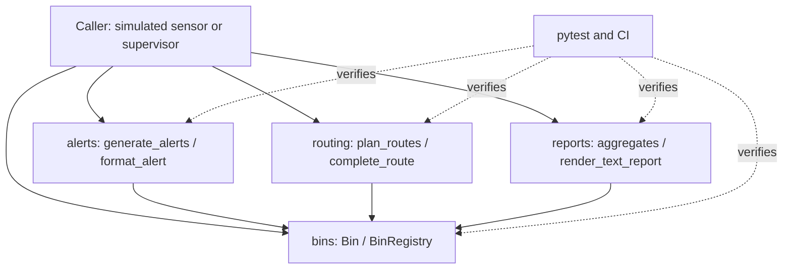
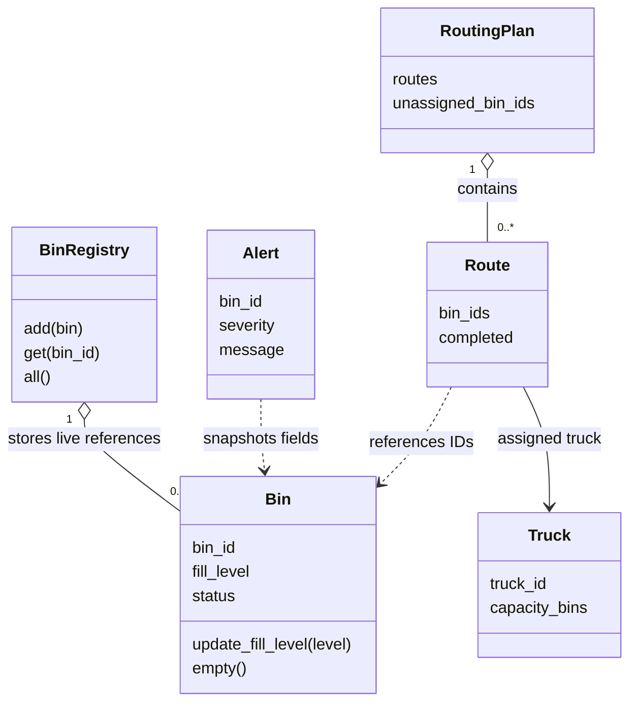

# Software Architecture and Design Specification

**Project:** Smart City Waste Management System
**Document:** SAD-SCWM-1.1
**Author:** Shreya Yashodhara Singh (`yasho-26singh`)
**Date:** 9 November 2026
**Status:** Follow-up revision for independent review; no institutional acceptance claimed
**Source baseline:** main `1344aaf94155af94c4832ed0a3bfc371f8ff1f63`

## Revision History

| Version | Date | Author | Change Summary |
|---|---|---|---|
| 1.0 | 8 November 2026 | Shreya | Initial SAD, merged in PR #6; editorial cleanup in #7 |
| 1.1 | 9 November 2026 | Shreya | Align with integrated reports/STP; follow supplied SAD template; add risks, stakeholder concerns, security assessment and provisional SRS v2 crosswalk |

## Approvals

| Role | Name | Signature/Date |
|---|---|---|
| Author | Shreya Yashodhara Singh | Prepared 9 November 2026 |
| Independent teammate reviewer | Pending | Refer to live follow-up PR review |
| Repository maintainer | Pending | Refer to live merge record |
| Course evaluator | Not recorded | No approval inferred |

## 1. Introduction

### 1.1 Purpose
Specify the actual architecture and design of the integrated Python package for
bin monitoring, alerts, priority collection and city reporting. This is an
IEEE-style description, not a claim of formal standards certification.

### 1.2 Scope
The baseline contains all four domain modules, unit/system tests, STP, test
document/report generators and published testing reports. Reports are implemented
and STP is merged. This revision changes documentation only. It does not implement
another teammate's feature or alter historical test results.

The merged baseline has no GUI or demo.py. PR #14 proposes a command-line demo;
Shreya's PR #16 proposes the Streamlit UI. Both were open when this revision was
prepared. Their implementation and passing checks do not establish merged-main
acceptance. The UI requirement remains open until integration and team acceptance.

### 1.3 Audience
Administrators/supervisors, developers, testers, maintainers and course evaluators.

### 1.4 Definitions
Bin fill is an integer percentage. Capacity for routing counts bins, not litres.
Backlog means due bins not assigned to the fleet. See glossary in section 5.1.

## 2. Document Overview

### 2.1 How to use this document
Section 3 describes architecture, boundaries, risks and requirement allocation.
Section 4 gives runtime sequences, APIs and operational limitations. Section 5
maps this document to the supplied SAD template and links the evidence. Preserve
the distinction between merged behavior, historical measurements and pending PRs.

### 2.2 Related Documents
[SRS](SRS.md), [STP](STP.md), [routing contract](ROUTING.md),
[Test Case Document](Test_Case_Document.md), [Day 3 validation](DAY3_VALIDATION.md),
[Unit Test Report](Unit_Test_Report.md), [System Validation Report](System_Validation_Report.md),
[Code Coverage Report](Code_Coverage_Report.md), [Branch Coverage Report](Branch_Coverage_Report.md).
The merged SRS still defines FR-1..8/NFR-1..4. SRS v2 PR #13 is unmerged and
under review; its additional IDs are explicitly provisional in section 3.8.

## 3. Architecture

### 3.1 Goals & Constraints
Keep status policy in one domain model; expose deterministic alert and collection
behavior; prevent validated operations from silently corrupting existing readings;
support isolated tests and independent feature review. The package targets Python
3.10+ with standard-library runtime dependencies. CI config uses Windows/Python
3.12; local checks use Python 3.13.7. That is not a test of every supported version.
No hardware, road network, database, persistence or multi-user dispatch is present.
Streamlit would add a dependency and local browser/server boundary if PR #16 merges;
the package's standard-library constraint does not describe that optional UI layer.

### 3.2 Stakeholders & Concerns
| Stakeholder | Concern | Design response / limit |
|---|---|---|
| Administrator | Reliable inventory and summaries | Unique registry IDs; report functions read current bins; process exit loses data |
| Supervisor/crew | Overflow priority and safe completion | Critical-first alerts, fullest-first routes, capacity/backlog and guarded completion; caller confirms actual trip |
| Sensor simulator | Reject malformed readings | Bin.update_fill_level validates before assignment |
| Teammates/maintainers | Stable interfaces and attribution | Separate modules, explicit contracts, feature PRs and independent review |
| Testers/evaluators | Reproducible evidence and traceability | Test IDs, source baseline, coverage and explicit pending status; no fabricated approvals |

### 3.3 Component (UML) Diagram
The dependency view below shows components and their provided contracts; arrows
mean uses/reads, not network messages or deployment processes.



### 3.4 Component Descriptions
This UML class view complements the component dependency diagram with the main
registry/plan/route relationships.



| Component | Responsibility | Owner / state |
|---|---|---|
| bins | Bin data, validation, status, registry and emptying | Sasyak; merged |
| alerts | Frozen alert snapshots, severity priority and plain-text format | Shreya; merged |
| routing | Validate fleet/threshold, allocate due bins, expose backlog, confirm completion | Shriya; merged |
| reports | Mean fill, status counts, means by waste type, total in text report | Shruti; merged |
| tests / report generators | Unit/system validation and recorded evidence | Integrated team work; reports remain tied to their recorded commits |

Data flow: caller updates a registry Bin, then passes registry.all() to alerts
and reports. Planning receives the registry itself and creates a RoutingPlan.
After operator confirmation, complete_route empties selected bins. Callers must
regenerate alerts and reports; previously returned values are snapshots.

### 3.5 Chosen Architecture Pattern and Rationale
Use a modular, domain-centred design with a caller/presentation boundary over the
domain model and read-only feature services. Bin owns status boundaries, so alerts
and reports do not duplicate policy. Passed registries avoid hidden global state.
Ordinary functions make tests inexpensive and deterministic. Separate services,
databases and geographic optimization would add unsupported complexity. This is
not a microservice deployment or a database-backed layered application.

### 3.6 Technology Stack & Data Stores
Python dataclasses, lists, tuples and dictionaries; pytest/pytest-cov and
coverage.py for tests; GitHub Actions for CI; Mermaid for diagrams. No persistent
data store is implemented. BinRegistry holds a dictionary of mutable Bin objects;
all() returns a new list containing the same objects. Bin.status derives from
fill_level: below 70 OK; 70..89 NEARLY_FULL; 90..100 FULL.

Alert is frozen with bin_id/severity/message. Old alerts never update themselves.
Truck is frozen with truck_id/capacity_bins. Route has truck, tuple bin_ids and
mutable completed flag. RoutingPlan is frozen but contains mutable Routes: it is
not deeply immutable. Report functions return numeric/dictionary/string snapshots;
the text report sorts waste-type lines. Empty input yields mean 0.0, zero status
counts, empty waste-type means and `No bins registered.`.

### 3.7 Risks & Mitigations
| Risk | Existing mitigation | Residual risk / next owner action |
|---|---|---|
| Malformed reading | Type/range checks before assignment | Public attributes can bypass setters; trusted callers use supported methods |
| Stale/missing route bins | Resolve every ID before emptying; reject repeat completion | No reservations or versioning; caller manages one active nonoverlapping plan |
| Data loss | No hidden disk writes | Process memory is volatile; persistence is a future requirement |
| Outdated alerts/reports | Read-only regeneration from current registry | Caller must refresh snapshots after changes |
| Large fleet/data | Simple priority sort and bounded assignment | No real-city load benchmark; unbounded inputs may exhaust resources |
| Documentation drift | Baseline and provisional-ID crosswalk | Reconcile after #13/#14/#16 merge; do not rewrite another owner's deliverables |
| Misstated evidence | Keep historical snapshots and exact run counts separate | Course acceptance, recordings, board fields and full version range remain unverified |

### 3.8 Traceability to Requirements
The following rows allocate the **merged SRS** to real code/tests. They identify
existing verification, not a promise of certification or all-environment coverage.

| Requirement | Design responsibility | Verification |
|---|---|---|
| FR-1 | BinRegistry | TC-BIN-06..10 |
| FR-2 | Bin.update_fill_level | TC-BIN-03,11,12 |
| FR-3 | Bin.status | TC-BIN-04 |
| FR-4 | Alert generation/format | TC-AL-01..06 |
| FR-5 | Truck, plan_routes | TC-RT-01..04,06,07,09,10 |
| FR-6 | RoutingPlan.unassigned_bin_ids | TC-RT-05 |
| FR-7 | complete_route | TC-RT-08,11,12; TC-AL-06 |
| FR-8 | reports (merged) | TC-RP-01..09; SYS-01, SYS-04 |
| NFR-1 | Domain checks and explicit exceptions | Invalid input/state preservation tests |
| NFR-2 | Small in-memory operations | Measure final full-suite duration; Day 3 is not final system evidence |
| NFR-3 | pytest-cov branch instrumentation | Separate statement and branch totals, each >=80% |
| NFR-4 | GitHub branches, reviews, CI | Live PR and Actions evidence |


Proposed SRS v2 crosswalk (PR #13 head `24db2266afdf31eb0d9bfff8f1feccfa27bc7ae7`):
these IDs are draft until accepted; reconcile them after that PR resolves.

| Proposed ID | Component/contract | Existing evidence / qualification |
|---|---|---|
| FR-9 | Bin constructor validation | TC-BIN-02 |
| FR-10 | Bin.empty | TC-BIN-05; SYS-01 |
| FR-11 | BinRegistry.by_status | TC-BIN-10 |
| FR-12 | format_alert | TC-AL-04 |
| FR-13 | Truck/fleet validation | TC-RT-09,10 |
| FR-14 | Threshold validation | TC-RT-07 |
| FR-15 | Completion guards/atomic lookup | TC-RT-08,11,12; SYS-04 |
| FR-16 | Text report and empty-data message | TC-RP-05,06 |
| NFR-5 | Stable alert/route/report order | TC-AL-03; TC-RT-02; report-line order visible in source but no focused test claimed |
| NFR-6 | Python 3.10+ compatibility target | CI 3.12 and local 3.13 evidence; no 3.10/3.11 result claimed; pending UI adds external dependencies |
| SR-1 | Reading validation | TC-BIN-03,11,12 |
| SR-2 | Bin creation checks | TC-BIN-02; limited validation as described in section 4.3 |
| SR-3 | Validate before emptying; reject repeat | TC-RT-08,11,12; SYS-04 |
| SR-4 | Read-only alerts/reports | TC-AL-03; TC-RP-09 |
| SR-5 | Controlled repository changes | PR/CI history; live ruleset/security audit not independently repeated in this revision |

### 3.9 Security Architecture
Objectives: preserve valid readings, fail safely on inconsistent operations, and
keep repository changes reviewable. The trust boundary is the caller invoking a
local package. No user roles are enforced by code. STRIDE-style assessment:

| Threat | Implemented control | Remaining limitation |
|---|---|---|
| Spoofing / elevation | None at application level | No login, role checks or authenticated sensor identity; trusted local callers only |
| Tampering | Supported setters validate readings; completion validates IDs and route shape | Direct field assignment can bypass checks; registry stores live references |
| Repudiation | Version-controlled source and PR/CI records | No runtime audit trail; PR history does not prove physical collection |
| Information disclosure | No external communication in merged package | No encryption/access controls on memory or text output; use synthetic data |
| Denial of service | No external listener in merged package | No rate limits, resource quotas or city-scale performance guarantee |

No authentication, encryption, secure storage, transactions or monitoring is
invented by this document. Network exposure through a future UI requires a fresh
boundary review. Local Streamlit acceptance is not production security approval.

## 4. Design

### 4.1 Design Overview
Constructor/setter validation precedes state mutation. Bin.status derives policy;
alerts map it to severity and stable-sort critical first; reports aggregate current
data. Routing selects by inclusive threshold, sorts fullest-first with bin-ID ties
and fills trucks in supplied order. Only completion mutates selected bins.

### 4.2 UML Sequence Diagrams
#### Sensor update to refreshed alerts
```mermaid
sequenceDiagram
    actor Sensor as Simulated sensor caller
    participant Registry as BinRegistry
    participant Bin
    participant Alerts as alerts module
    Sensor->>Registry: get(bin_id)
    Registry-->>Sensor: Bin (or KeyError)
    Sensor->>Bin: update_fill_level(level)
    alt integer in 0..100
        Bin->>Bin: assign fill_level
        Sensor->>Registry: all()
        Registry-->>Sensor: list of Bin
        Sensor->>Alerts: generate_alerts(bins)
        Alerts->>Bin: read status and fields
        Alerts-->>Sensor: fresh list, CRITICAL first
    else invalid reading
        Bin-->>Sensor: ValueError; prior level preserved
    end
```

#### Planning to confirmed collection
```mermaid
sequenceDiagram
    actor Supervisor
    participant Routing
    participant Registry as BinRegistry
    participant Bin
    Supervisor->>Routing: plan_routes(registry, trucks, threshold=70)
    Routing->>Registry: all()
    Registry-->>Routing: bins
    Routing->>Routing: validate fleet; sort due; assign capacity
    Routing-->>Supervisor: RoutingPlan(routes, unassigned_bin_ids)
    Note over Supervisor: confirm actual simulated collection completed
    Supervisor->>Routing: complete_route(route, registry)
    Routing->>Routing: reject repeated / invalid route
    Routing->>Registry: get every route bin_id before mutation
    alt any bin missing
        Registry-->>Routing: KeyError
        Routing-->>Supervisor: error; no bin emptied
    else all present
        Routing->>Bin: empty() for each selected bin
        Routing->>Routing: route.completed = True
        Routing-->>Supervisor: None
    end
```

After successful completion, the caller may pass registry.all() to status_summary
and render_text_report; SYS-01 verifies regenerated status and mean fill.

### 4.3 API Design
Public interfaces are Python calls, not HTTP endpoints. At least bins, alerts,
routing and reports are specified here.

| API | Contract |
|---|---|
| Bin(bin_id, location, capacity_litres, waste_type='general', fill_level=0) | Reject empty ID, nonpositive capacity, unsupported waste type; validate reading |
| Bin.update_fill_level(level) | Integer 0..100; bool, noninteger and out-of-range raise ValueError |
| Bin.empty(); Bin.status | Set zero; derived classification |
| BinRegistry.add/get/remove/all/by_status | Duplicate add ValueError; missing get/remove KeyError; lists contain live Bin references |
| Alert(bin_id, severity, message) | Immutable data value, no constructor validation policy |
| generate_alerts(bins: list[Bin]) -> list[Alert] | No OK alerts; WARNING nearly full; CRITICAL full; stable input order within severity; no mutation |
| format_alert(alert) -> str | `[SEVERITY] message`; plain text, not HTML escaping |
| Truck(truck_id, capacity_bins) | Nonblank string ID, positive integer capacity; invalid values ValueError |
| plan_routes(registry, trucks, threshold=70) -> RoutingPlan | Registry input; inclusive integer 0..100 threshold; invalid fleet/duplicate truck IDs ValueError |
| complete_route(route, registry) -> None | Empty route/overcapacity/duplicate IDs/repeat completion ValueError; missing bin KeyError before mutation |

Planning sorts by descending fill then bin ID, uses supplied truck order, omits
empty routes, and returns unassigned IDs in priority order. Capacity counts bins,
not litres. Empty fleet leaves all due bins unassigned. Callers catch documented
exceptions at their presentation boundary; this package does not translate them
to HTTP codes. Alerts require valid Bin instances; unsupported object types are
not a validated external input protocol. Do not call obsolete complete_collection,
use dictionary-style plan access, or pass registry.all() to plan_routes.


| Report API (all take list[Bin]) | Return / empty-data behavior |
|---|---|
| average_fill_level(bins) | Mean percentage rounded to two decimals; 0.0 if empty |
| status_summary(bins) | Dictionary with OK, NEARLY_FULL, FULL counts; all zero if empty |
| summary_by_waste_type(bins) | Mean fill per represented waste type; empty dictionary if empty |
| render_text_report(bins) | Plain text containing total, mean, counts and sorted waste-type means; empty-data message if empty |

Bin ID checks reject falsey IDs, not every malformed identifier; capacity is
checked as positive, without a strict integer-type check. Truck/threshold checks
are stricter. Do not describe these as universal input sanitization. Read-only
features assume valid Bin objects and do not catch arbitrary caller type errors.

### 4.4 Error Handling, Logging & Monitoring
ValueError handles supported validation failures; KeyError handles unknown registry
IDs. Invalid readings preserve the previous level. Complete_route resolves all
IDs before emptying; a missing ID leaves all route bins unchanged. Completed,
duplicate, empty and overcapacity routes are rejected. There is no broader
transaction across separate route objects or simultaneous callers.

Callers handle errors at presentation boundaries; no HTTP error/status mapping
exists in merged main. Unexpected exceptions remain visible to the developer.
The package has no logger, audit store, telemetry, live monitoring or alert delivery
service. pytest/JUnit, generated reports and CI are development evidence rather
than operational monitoring. Logging and dispatch audit are proposed extensions.

### 4.5 UX Design
Merged baseline is used through Python calls and plain-text reports. The expected
journey is register bins, update simulated readings, inspect alerts, plan, confirm
actual collection, then refresh reports. Clear domain exceptions tell the caller
what failed; the package does not implement a graphical error display.

PR #16 provides four proposed Streamlit tabs (Bins, Alerts, Collection routes,
City report), session state, domain-error display and stale-plan invalidation.
It has separate browser/AppTest evidence, but remains unmerged at this revision.
No GUI or accessibility acceptance is claimed for main. PR #14's command-line
demo and its acceptance test are also pending integration.

### 4.6 Open Issues & Next Steps
1. Reviewer approves this revision; maintainer merges after checks. No self-approval.
2. Reconcile draft SRS v2 IDs and affected documents after PR #13 is accepted.
3. Recheck architecture/dependencies after demo/UI merge; distinguish application
   server communication from the currently standalone domain package.
4. Coordinate final evidence with Shruti; do not overwrite archived measurements.
5. Confirm actual course deadline/extension: supplied testing window was 2-6
   November and has elapsed. Do not backdate work or claim instructor acceptance.
6. Record the required 1-minute and 2-minute working-product sprint videos and
   verify backlog owners/points and actual two-sprint outcomes with the team.
   Four teammate workdays do not prove four course sprints.

## 5. Appendices

### 5.1 Glossary
| Term | Meaning |
|---|---|
| SAD / SRS / STP | Architecture/design specification / requirements / test plan |
| FR / NFR / SR / SO | Functional / nonfunctional / security requirement / security objective |
| Snapshot | Value reflecting one moment; regenerate after state changes |
| Registry | In-memory dictionary of live Bin objects keyed by ID |
| Backlog | Due bin IDs not assigned to available truck capacity |
| STRIDE | Spoofing, Tampering, Repudiation, Information disclosure, Denial of service, Elevation of privilege |
| CI | Automated checks of repository changes, not runtime monitoring |

### 5.2 References and Template Crosswalk
The supplied `SAD_Template (1).docx` was extracted from the Resources.bin embedded
package in `Shreya_Handoff.docx`. Its ATM examples are not system requirements.
This revision follows its section names/numbers directly: title/version/authors,
revision history and approvals; 1.1-1.4 introduction; 2.1-2.2 overview;
3.1-3.9 architecture; 4.1-4.6 design; 5.1-5.3 appendices. The component/dependency
diagram is section 3.3, both sequence diagrams are unchanged in 4.2, API contracts
are in 4.3 and the threat assessment is in 3.9. No ATM-specific technologies,
availability promises, PCI-DSS claims, signatures or dates have been copied.

Source of truth is the stated main baseline and linked project documents in
section 2.2. Open PR #13 is a proposed requirement mapping, not accepted evidence.
Old SAD section-7 API references in pending SRS changes should be updated by that
document's owner to section 4.3 after this revision is accepted.

### 5.3 Tools and Validation Evidence
Python, pytest, pytest-cov/coverage.py, GitHub Actions, Markdown and Mermaid.
The four published reports and HTML coverage are present, but their recorded
commit/environment differ from this baseline; presence is not new execution.
Day 3's 68-test record remains a historical snapshot. The integrated baseline
contains 86 cases. On 9 November 2026, `python -m pytest --cov --cov-branch
--cov-report=term-missing --cov-report=json:../sad-coverage.json` passed all 86
tests in 0.71 seconds on Windows/Python 3.13.7: 140/140 statements and 54/54
branch outcomes (100% each). Source/tests are unchanged from the stated baseline.
This is a fresh local baseline check; the older archived reports are not relabelled.
The separate unmerged UI branch has additional AppTest cases and cannot be used
as this baseline's count or performance evidence. This revision introduces no
runtime/test changes. The companion VIVA_VIDEO_NOTES.md is preparation material,
not a claim that recording or human understanding has been completed.
