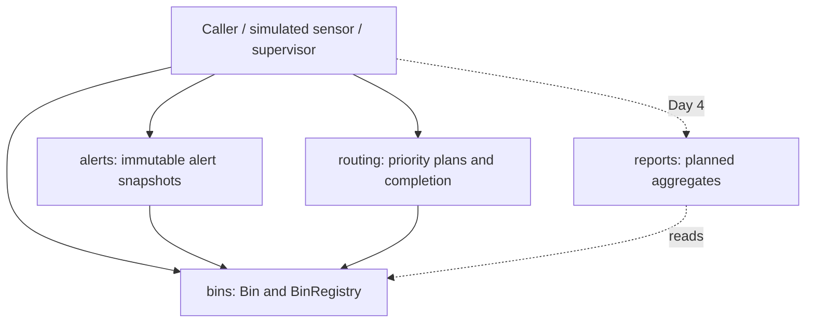

# Software Architecture Document

## 1. Identification and purpose
SAD-SCWM-1.0, 8 November 2026. Author: Shreya Yashodhara Singh
(`yasho-26singh`).
IEEE-style architecture description; no formal standards certification claimed.
Describes SRS FR-1 through FR-8 and NFR-1 through NFR-4. References:
[SRS](SRS.md), [routing contract](ROUTING.md), [test plan](STP.md) (PR #4).

## 2. Scope, stakeholders and constraints
City administrators maintain bins; collection supervisors inspect alerts and plan
collection. The package simulates sensor readings in one Python process. Python
3.10+ and standard-library runtime only. No database, hardware, network API,
authentication, UI or road-distance model exists. Reports are a Day 4 component,
not an implemented part of this Day 3 baseline. STP remains in a separate PR.

## 3. Architectural decisions and component view
Use a modular domain-centred design. Bin owns classification and validated
reading updates; features consume that policy rather than duplicating thresholds.
Explicit function calls and passed registries avoid hidden global state. This is
appropriate for the small testable simulation; persistence and concurrent dispatch
would need new boundaries. Priority assignment meets FR-5 without inventing map data.



| Component | Responsibility and ownership |
|---|---|
| bins / Sasyak | Store bins by ID; validate readings; derive status; empty bins |
| alerts / Shreya | Convert status to WARNING/CRITICAL; stable critical-first output; text formatting |
| routing / Shriya | Validate trucks, select due bins, allocate capacities, expose backlog, complete routes |
| reports / Shruti (planned) | Total/mean fill, status counts and means by waste type |
| tests and CI | Regression, traceability and measured coverage; independent PR review |

## 4. Data and state view
Bin fields are bin_id, location, capacity_litres, waste_type and fill_level.
BinRegistry owns a dictionary of IDs to mutable Bin objects; all() returns a new
list of the same objects. Bin.status is derived: <70 OK, 70..89 NEARLY_FULL,
90..100 FULL. There is no redundant stored status.

Alert is a frozen dataclass (bin_id, severity, message). Alerts are snapshots:
regenerate after readings or collection, because old instances do not update.
Truck is frozen (truck_id, capacity_bins). Route holds truck, tuple bin_ids and
mutable completed flag. RoutingPlan is frozen but contains mutable Routes;
it is not deeply immutable. Neither a plan nor registry survives process exit.

## 5. Runtime view: sensor to alert
```mermaid
sequenceDiagram
    actor Sensor as Simulated sensor caller
    participant Registry as BinRegistry
    participant Bin
    participant Alerts as alerts module
    Sensor->>Registry: get(bin_id)
    Registry-->>Sensor: Bin (or KeyError)
    Sensor->>Bin: update_fill_level(level)
    alt integer in 0..100
        Bin->>Bin: assign fill_level
        Sensor->>Registry: all()
        Registry-->>Sensor: list of Bin
        Sensor->>Alerts: generate_alerts(bins)
        Alerts->>Bin: read status and fields
        Alerts-->>Sensor: fresh list, CRITICAL first
    else invalid reading
        Bin-->>Sensor: ValueError; prior level preserved
    end
```

## 6. Runtime view: planning and confirmed collection
```mermaid
sequenceDiagram
    actor Supervisor
    participant Routing
    participant Registry as BinRegistry
    participant Bin
    Supervisor->>Routing: plan_routes(registry, trucks, threshold=70)
    Routing->>Registry: all()
    Registry-->>Routing: bins
    Routing->>Routing: validate fleet; sort due; assign capacity
    Routing-->>Supervisor: RoutingPlan(routes, unassigned_bin_ids)
    Note over Supervisor: confirm actual simulated collection completed
    Supervisor->>Routing: complete_route(route, registry)
    Routing->>Routing: reject repeated / invalid route
    Routing->>Registry: get every route bin_id before mutation
    alt any bin missing
        Registry-->>Routing: KeyError
        Routing-->>Supervisor: error; no bin emptied
    else all present
        Routing->>Bin: empty() for each selected bin
        Routing->>Routing: route.completed = True
        Routing-->>Supervisor: None
    end
```

## 7. Public interfaces and error protocol
| API | Contract |
|---|---|
| Bin(id, location, capacity_litres, waste_type='general', fill_level=0) | Reject empty ID, nonpositive capacity, unsupported waste type; validate reading |
| Bin.update_fill_level(level) | Integer 0..100; bool, noninteger and out-of-range raise ValueError |
| Bin.empty(); Bin.status | Set zero; derived classification |
| BinRegistry.add/get/remove/all/by_status | Duplicate add ValueError; missing get/remove KeyError; lists contain live Bin references |
| Alert(bin_id, severity, message) | Immutable data value, no constructor validation policy |
| generate_alerts(bins: list[Bin]) -> list[Alert] | No OK alerts; WARNING nearly full; CRITICAL full; stable input order within severity; no mutation |
| format_alert(alert) -> str | `[SEVERITY] message`; plain text, not HTML escaping |
| Truck(truck_id, capacity_bins) | Nonblank string ID, positive integer capacity; invalid values ValueError |
| plan_routes(registry, trucks, threshold=70) -> RoutingPlan | Registry input; inclusive integer 0..100 threshold; invalid fleet/duplicate truck IDs ValueError |
| complete_route(route, registry) -> None | Empty route/overcapacity/duplicate IDs/repeat completion ValueError; missing bin KeyError before mutation |

Planning sorts by descending fill then bin ID, uses supplied truck order, omits
empty routes, and returns unassigned IDs in priority order. Capacity counts bins,
not litres. Empty fleet leaves all due bins unassigned. Callers catch documented
exceptions at their presentation boundary; this package does not translate them
to HTTP codes. Alerts require valid Bin instances; unsupported object types are
not a validated external input protocol. Do not call obsolete complete_collection,
use dictionary-style plan access, or pass registry.all() to plan_routes.

## 8. Security and integrity architecture
Objective 1: preserve valid domain state. Reading validation rejects malformed
values before assignment; routing resolves all IDs before emptying and rejects
repeat completion. Objective 2: preserve trustworthy changes and evidence. Use
reviewed PRs, CI and reproducible tests without credentials in source. Repository
controls are workflow controls, not application authentication.

Limitations: public mutable Bin/Route fields can bypass setters; IDs and capacity
have only the checks described above. Trusted callers must use supported methods.
Plans can overlap and have no reservation/version check. Caller must manage one
active collection plan and avoid stale or concurrent completion. No transaction,
durability, role checks, audit log or encryption is implemented. A future UI must
validate inputs and safely render location/message text; adding network services
requires authentication and authorization design before exposure.

## 9. Requirement allocation and verification
| Requirement | Design responsibility | Verification |
|---|---|---|
| FR-1 | BinRegistry | TC-BIN-06..10 |
| FR-2 | Bin.update_fill_level | TC-BIN-03,11,12 |
| FR-3 | Bin.status | TC-BIN-04 |
| FR-4 | Alert generation/format | TC-AL-01..06 |
| FR-5 | Truck, plan_routes | TC-RT-01..04,06,07,09,10 |
| FR-6 | RoutingPlan.unassigned_bin_ids | TC-RT-05 |
| FR-7 | complete_route | TC-RT-08,11,12; TC-AL-06 |
| FR-8 | reports (Day 4 planned) | TC-RP-01..06 and system cases pending |
| NFR-1 | Domain checks and explicit exceptions | Invalid input/state preservation tests |
| NFR-2 | Small in-memory operations | Measure final full-suite duration; Day 3 is not final system evidence |
| NFR-3 | pytest-cov branch instrumentation | Separate statement and branch totals, each >=80% |
| NFR-4 | GitHub branches, reviews, CI | Live PR and Actions evidence |

## 10. Deployment, quality and evolution
Clone repository, install requirements.txt, run `python -m pytest --cov
--cov-branch --cov-report=term-missing`. pytest.ini configures the src import path;
there is no installed CLI entry point. CI uses Windows/Python 3.12; Day 3 local
validation uses Windows/Python 3.13.7. See DAY3_VALIDATION.md for actual results.
Keep this architecture synchronized when reports/UI/persistence are added.
UI, final reports, system validation and demo videos remain separate team work.
