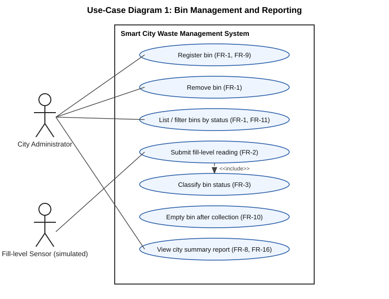
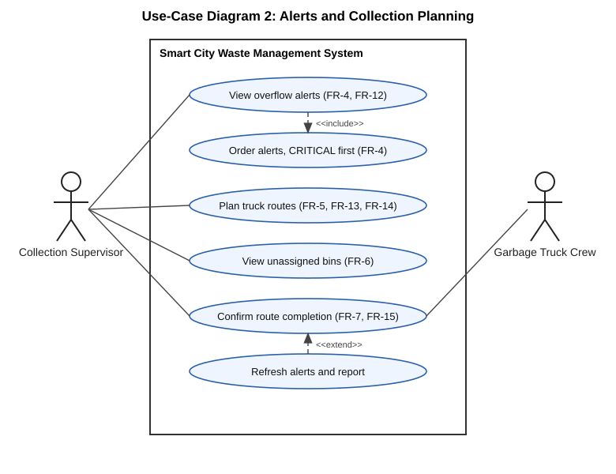

# Software Requirements Specification (SRS)

**Project:** Smart City Waste Management System
**Version:** 2.1
**Date:** 9 November 2026
**Authors:** Sasyak Subudhi (PES1UG24AM256), Shriya Vasundhara Singh (PES1UG24AM269), Shreya Yashodhara Singh (PES1UG24AM266), Shruti Choudhary (PES1UG24AM271)
**Course:** Software Engineering, PES University
**Status:** Updated after implementation and UI integration; version 2.1 merged after independent review (PR #21). Course coordinator and repository owner sign-off in the Approvals table is not recorded

## Revision history
| Version | Date | Author | Change summary | Approval |
|---|---|---|---|---|
| 1.0 | 7 Nov 2026 | Sasyak Subudhi | Initial SRS: FR-1 to FR-8, NFR-1 to NFR-4 (PR #2) | Merged after review |
| 2.0 | 9 Nov 2026 | Sasyak Subudhi | Added FR-9 to FR-16, NFR-5 and NFR-6, security objectives and requirements, external interfaces, two use-case diagrams and a requirements traceability matrix; FR-2 tightened to whole numbers (see `docs/DEVIATIONS.md`) | Merged after independent review (PR #13) |
| 2.1 | 9 Nov 2026 | Sasyak Subudhi | Updated for the Streamlit web UI now merged in PR #16 (with SAD #17 and STP #18): clarified NFR-2 (performance) and NFR-6 (portability), separated the domain package from the UI and its dependencies, and qualified the no-network statements. No instructor acceptance is claimed | Merged after independent review (PR #21, approved by two teammates) |

## Approvals
| Role | Name | Signature / Email | Date |
|---|---|---|---|
| Course Coordinator | | | |
| Repository owner | Sasyak Subudhi | | |

## Table of contents
1. Introduction
2. Overall description
3. External interfaces
4. System features (functional requirements)
5. Non-functional requirements (including security)
6. Quality attributes and acceptance tests
7. System models and diagrams (UML use cases)
8. Requirements traceability matrix

## 1. Introduction

### 1.1 Purpose
This document specifies the requirements of a Smart City Waste Management System that monitors the fill level of public waste bins, raises alerts for bins that need emptying, plans collection routes for garbage trucks, and produces summary reports for city administrators.

### 1.2 Scope
The system receives fill-level readings (simulated sensor data), classifies each bin, alerts operators, assigns due bins to trucks and summarises city-wide status. It does not control physical hardware and does not use road distances or coordinates. The domain package has no network service or user authentication; the Streamlit web UI (see 3.1) adds a browser-to-local-server boundary but no authentication (see 5.3 and `docs/DEVIATIONS.md`).

### 1.3 Audience
Developers, testers, the repository owner who reviews pull requests, and course evaluators.

### 1.4 Definitions
| Term | Meaning |
|---|---|
| Fill level | Whole-number percentage (0-100) of a bin's capacity currently used |
| OK | Fill level below 70% |
| NEARLY_FULL | Fill level 70-89% |
| FULL | Fill level 90% or more |
| Threshold | Fill level at or above which a bin is due for collection (default 70%) |
| Route | Ordered list of bin IDs assigned to one truck for one trip |
| Backlog (routing) | Due bins that no truck could take because all trucks were full |
| CI | Continuous integration: GitHub Actions runs the tests on every pull request |

### 1.5 Users
- **City administrator:** registers and removes bins, views reports.
- **Collection supervisor:** reviews alerts, plans truck routes, confirms completed collections.
- **Sensor (simulated):** supplies fill-level readings.
- **Truck crew:** performs the collection that the supervisor confirms.

## 2. Overall description

### 2.1 Product perspective
A standalone Python application: the domain package `waste_mgmt` with four modules (bins, alerts, routing and reports), plus a Streamlit web dashboard (`app.py`, `src/waste_mgmt/dashboard.py`) that calls the package's public APIs. See `docs/SAD.md` for the architecture and `docs/UI.md` for the UI.

### 2.2 Major product functions
- Register, list, filter and remove bins, with validation
- Accept fill-level readings and classify each bin
- Generate WARNING and CRITICAL alerts
- Plan capacity-limited truck routes, fullest bins first, and report bins left unassigned
- Mark bins empty when a collection is confirmed
- Produce summary statistics and a plain-text city report

### 2.3 User roles and characteristics
Administrators and supervisors are non-programmers in the real world; in this project they are represented by the Python API. The Streamlit web UI (see 3.1) is merged (PR #16); a command-line demo script (`demo.py`, PR #14) is merged.

### 2.4 Operating environment
Target: Python 3.10 or later on any operating system. Actually tested so far: CI runs Python 3.12 on Windows, and the suite was also run locally on Windows with Python 3.13.7 (not part of CI); 3.10 and 3.11 have not been tested.

### 2.5 Constraints
The domain package `waste_mgmt` (bins, alerts, routing, reports) uses only the Python standard library at runtime and has no network service. The merged web UI (PR #16) adds one direct dependency declared in `requirements.txt`, Streamlit (`streamlit>=1.40`), which brings transitive packages, and it runs through a local Streamlit server viewed in a browser; the tests need `pytest` and `pytest-cov`. There is no hardware or database; capacity is counted in bins per truck, not litres.

## 3. External interfaces

### 3.1 User interfaces
The domain package has no graphical interface of its own and is used through the Python API. The original project request asks for a UI. A four-tab Streamlit web dashboard (owner: Shreya Yashodhara Singh; `app.py`, `docs/UI.md`) is merged in PR #16 and calls the package's public APIs; a command-line demo (`demo.py`, PR #14) is merged. This records that the UI exists; it does not claim instructor acceptance, production readiness or a browser or accessibility evaluation beyond the automated tests.

### 3.2 Hardware interfaces
None. Sensor readings are simulated by calling `Bin.update_fill_level`.

### 3.3 Software interfaces
Public Python API of the `waste_mgmt` package: `Bin`, `BinRegistry`, `generate_alerts`, `format_alert`, `Truck`, `plan_routes`, `complete_route`, and the report functions. Contracts and error behaviour are in section 4.3 of `docs/SAD.md`.

### 3.4 Communications
None for the domain package: it makes no network calls. The Streamlit UI is served by a local Streamlit server and viewed in a browser; no sensor network, TLS, authentication or deployment is specified or tested.

## 4. System features (functional requirements)

Each requirement has a test reference in section 8.

| ID | Requirement | Module |
|---|---|---|
| FR-1 | The system shall let an administrator add, retrieve, list and remove bins. Duplicate bin IDs shall be rejected and unknown IDs shall raise an error. | bins |
| FR-2 | The system shall accept a fill-level reading for a bin and reject values that are not whole numbers from 0 to 100 (including NaN, infinity, booleans, decimals, text and missing values). | bins |
| FR-3 | The system shall classify each bin as OK, NEARLY_FULL or FULL using the boundaries in 1.4. | bins |
| FR-4 | The system shall generate a WARNING alert for NEARLY_FULL bins and a CRITICAL alert for FULL bins, listing CRITICAL first. | alerts |
| FR-5 | The system shall select bins at or above a configurable threshold, fullest first (ties by bin ID), and assign them to trucks without exceeding truck capacity. | routing |
| FR-6 | The system shall report bins that could not be assigned because the fleet is full, in priority order and without duplicates. | routing |
| FR-7 | The system shall mark bins as emptied once a truck completes its route. | routing |
| FR-8 | The system shall report total bins, average fill level, a count per status and average fill per waste type. | reports |
| FR-9 | The system shall reject a bin with an empty ID, a non-positive capacity or an unsupported waste type (supported: general, recyclable, organic). | bins |
| FR-10 | The system shall let an operator reset a bin to 0% after collection. | bins |
| FR-11 | The system shall list the bins that currently have a given status. | bins |
| FR-12 | The system shall present each alert as plain text in the form `[SEVERITY] message` naming the bin, its location and its fill level. | alerts |
| FR-13 | The system shall reject a truck with a blank ID or a non-positive whole-number capacity, and shall reject a fleet with duplicate truck IDs. | routing |
| FR-14 | The system shall reject a collection threshold that is not a whole number from 0 to 100. | routing |
| FR-15 | The system shall refuse to complete a route that is empty, over capacity, contains duplicate bins or was already completed, and shall change no bin if any bin on the route is missing. | routing |
| FR-16 | The system shall produce a plain-text city report, or the message "No bins registered." when there are no bins. | reports |

## 5. Non-functional requirements

### 5.1 General non-functional requirements
| ID | Category | Requirement | Measurement |
|---|---|---|---|
| NFR-1 | Reliability | Invalid input shall raise a clear error rather than silently corrupt data. | Invalid-input tests pass and leave existing state unchanged |
| NFR-2 | Performance | The original target is that the full automated test suite runs in under 10 seconds. Proposed revision, awaiting team and instructor acceptance: apply the 10 second limit to the core-package tests (bins, alerts, routing, reports and system scenarios) and agree a separate criterion for the dashboard tests. | Historical core-only observations on the 86-test baseline, before UI integration: 2.95 s and 6.49 s in independent runs and 4.26 s in the 9 Nov recording run (Windows, Python 3.13.7); these are not a fresh selective-core run after integration. Full expanded suite at PR #16's head: 109 passed in 33.99 s (independent run, Windows, Python 3.13.7; 156/156 statements and 56/56 branch outcomes for `src/waste_mgmt`). UI-only time has not been measured. The original whole-suite target is therefore not met |
| NFR-3 | Quality | Statement and branch coverage shall each be at least 80%. | Code and Branch Coverage Reports |
| NFR-4 | Process | Code shall be maintained in Git with changes merged only via reviewed pull requests passing CI. | GitHub pull request history and branch ruleset |
| NFR-5 | Determinism | The same inputs shall always give the same ordering of alerts, routes and report lines. | Tie-break and stability tests for alerts and routing; report-line ordering is not separately tested |
| NFR-6 | Portability | The domain package shall run on Python 3.10 or later using only the standard library. The Streamlit UI is a separate layer with its own declared dependency (`streamlit>=1.40`, plus transitive packages), so the standard-library-only statement does not apply to it. | CI: Windows, Python 3.12. Observed local run (not CI): Windows, Python 3.13.7. Python 3.10 and 3.11 are untested; no portability or UI performance acceptance is claimed beyond these observations |

### 5.2 Security

#### 5.2.1 Security objectives
| ID | Objective |
|---|---|
| SO-1 | **Data integrity:** the state of every bin (fill level, status) changes only through validated operations. |
| SO-2 | **Safe failure:** invalid or inconsistent requests are rejected with a clear error and leave the system state exactly as it was. |
| SO-3 | **Controlled change:** source code reaches the main branch only through reviewed, tested changes. |

#### 5.2.2 Security requirements
| ID | Requirement | Objective |
|---|---|---|
| SR-1 | Fill-level readings shall be validated for type and range before being stored; booleans, NaN, infinity, decimals and text shall be rejected. | SO-1 |
| SR-2 | Bin identifiers, capacities and waste types shall be validated when a bin is created. | SO-1 |
| SR-3 | Completing a route shall verify every bin before changing any of them, and a route shall not be completed twice. | SO-2 |
| SR-4 | Alert and report generation shall be read-only and shall never modify a bin. | SO-1 |
| SR-5 | Changes to the main branch shall require a pull request with an independent approval and a passing CI check; credentials shall never be committed. | SO-3 |

### 5.3 Known security limitations
The domain package has no user authentication, authorisation, encryption or network exposure. The Streamlit UI adds a browser-to-local-server boundary; no authentication, TLS, deployment or network-sensor feature is specified or tested. These would need to be added before the system is deployed as a service.

## 6. Quality attributes and acceptance tests
- **Exit criteria:** all functional requirements implemented and verified by automated tests, no failing test, statement and branch coverage each at least 80%, and the traceability matrix showing a passing test for every requirement. NFR-2 and NFR-6 are partial (see section 5.1 and section 8); the instructor's view on the UI and on test-suite time is not recorded.
- **Acceptance test suites:** unit tests (`tests/test_bins.py`, `test_alerts.py`, `test_routing.py`, `test_reports.py`), system scenarios SYS-01 to SYS-04 (`tests/test_system.py`), and the dashboard tests (`tests/test_dashboard.py`, `tests/test_app.py`). The demo script test is `tests/test_demo.py` (PR #14).
- **Evidence:** the four reports in `docs/` (Unit Test, System Validation, Code Coverage, Branch Coverage).

## 7. System models and diagrams

### 7.1 UML use-case diagrams
Diagram 1 covers bin management and reporting; diagram 2 covers alerts and collection planning.

## 8. Requirements traceability matrix
Test IDs come from the test function names (for example `TC-BIN-03` is `test_tc_bin_03_...`). Status: P = passing in the latest reports.

| Req ID | Requirement (short) | Type | Priority | Module | Test cases | Status |
|---|---|---|---|---|---|---|
| FR-1 | Add, get, list, remove bins; reject duplicates | Functional | High | bins | TC-BIN-06 to 09, SYS-01, SYS-04 | P |
| FR-2 | Validate fill-level readings | Functional | High | bins | TC-BIN-03, TC-BIN-11, TC-BIN-12, SYS-02 | P |
| FR-3 | Classify bin status | Functional | High | bins | TC-BIN-04, TC-RP-07 | P |
| FR-4 | WARNING / CRITICAL alerts, critical first | Functional | High | alerts | TC-AL-01 to 03, TC-AL-05, TC-AL-06, SYS-01, SYS-02 | P |
| FR-5 | Select due bins, assign within capacity | Functional | High | routing | TC-RT-01 to 04, TC-RT-06, SYS-01, SYS-02 | P |
| FR-6 | Report unassigned bins | Functional | High | routing | TC-RT-05, SYS-03 | P |
| FR-7 | Empty bins on route completion | Functional | High | routing | TC-RT-08, SYS-01 | P |
| FR-8 | Summary statistics | Functional | Medium | reports | TC-RP-01 to 04, TC-RP-07, TC-RP-08 | P |
| FR-9 | Reject invalid bin definitions | Functional | Medium | bins | TC-BIN-02 | P |
| FR-10 | Reset bin after collection | Functional | Medium | bins | TC-BIN-05, SYS-01 | P |
| FR-11 | List bins by status | Functional | Low | bins | TC-BIN-10 | P |
| FR-12 | Plain-text alert format | Functional | Low | alerts | TC-AL-04 | P |
| FR-13 | Validate trucks and fleet | Functional | Medium | routing | TC-RT-09, TC-RT-10 | P |
| FR-14 | Validate threshold | Functional | Medium | routing | TC-RT-07 | P |
| FR-15 | Safe route completion | Functional | High | routing | TC-RT-08, TC-RT-11, TC-RT-12, SYS-04 | P |
| FR-16 | Plain-text city report | Functional | Medium | reports | TC-RP-05, TC-RP-06 | P |
| NFR-1 | Clear errors, no corruption | Non-functional | High | all | TC-BIN-02, TC-BIN-11, TC-RT-07 to 12 | P |
| NFR-2 | Test suite under 10 s (core/UI split proposed) | Non-functional | Medium | all | Unit Test Report timings | Partial: full expanded suite 109 passed in 33.99 s exceeds 10 s; proposed split awaits acceptance |
| NFR-3 | Coverage at least 80% | Non-functional | High | all | Code and Branch Coverage Reports | P |
| NFR-4 | Reviewed pull requests with green CI | Non-functional | High | process | GitHub PR history, branch ruleset | P |
| NFR-5 | Deterministic ordering | Non-functional | Medium | alerts, routing, reports | TC-AL-03, TC-RT-02 (alerts and routing only) | Partial: report-line order not tested |
| NFR-6 | Python 3.10+; domain package standard library only (UI needs Streamlit) | Non-functional | Low | all | CI Python 3.12; local Python 3.13.7 | Partial: 3.10 and 3.11 untested; UI dependency noted |
| SR-1 | Validate reading type and range | Security | High | bins | TC-BIN-03, TC-BIN-11, TC-BIN-12 | P |
| SR-2 | Validate bin creation | Security | High | bins | TC-BIN-02 | P |
| SR-3 | Verify before change; no double completion | Security | High | routing | TC-RT-08, TC-RT-11, TC-RT-12, SYS-04 | P |
| SR-4 | Alerts and reports are read-only | Security | Medium | alerts, reports | TC-AL-03, TC-RP-09 | P |
| SR-5 | Protected main branch, no secrets committed | Security | High | process | GitHub ruleset "Protect main", PR history | P |
